# ClaudeXAndroidTV
Hack your old Android TV - Smarter / Cleaner / Faster

# CleanYourTV: Skyworth SWTV-20NA edition

Strip the ads, tracking and bloatware from an Android TV over Wi-Fi, and replace the ad-filled Google TV
home screen with a clean, fast launcher. Nothing is rooted, nothing is uninstalled, and one command undoes it all.

This repo is my copy of **[Gathin23/cleanyourtv](https://github.com/Gathin23/cleanyourtv)** (MIT), with the
exact setup I applied to a **Skyworth SWTV-20NA** (MediaTek, Android TV 11, build `RTM5.220609.106`) and
screenshots of every step. The tools and launcher work on most Android TV / Google TV sets. The upstream
project's full documentation is in [README.upstream.md](README.upstream.md).

| Before | After |
|---|---|
| 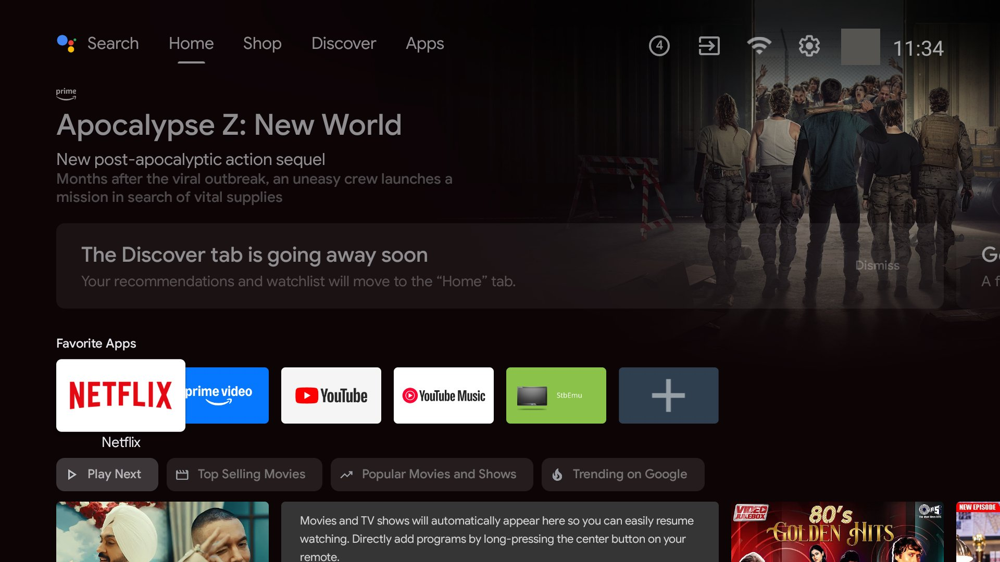 | 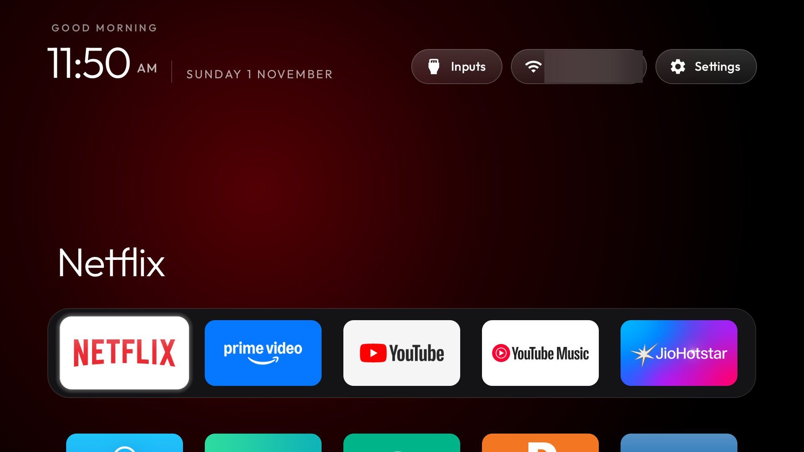 |

---

## What it does

| Step | What happens |
|---|---|
| **Back up** | Saves the installed package list and settings before any change. |
| **Disable** | Turns off the manufacturer's telemetry, ad services, sponsored rows and preloaded junk with `pm disable-user`. Nothing is uninstalled, so every change can be undone. |
| **Install** | Builds a small native launcher (`com.gathin.tvhome`, ~570 KB, no internet permission) and makes it the Home screen. |
| **DNS (optional)** | Sets Private DNS to AdGuard to block most ads and trackers in apps. |

---

## Requirements

- An **Android TV or Google TV** on the same Wi-Fi as your computer. Samsung (Tizen), LG (webOS), Roku and
  VIDAA sets are not Android, so this repo can't help them.
- A computer with **Git**, **Python 3**, and either **Docker Desktop** (easiest, used here) or a
  **JDK 17–22 + Android SDK platform 34 / build-tools 34**.
- On Windows, run the `.sh` scripts from **Git Bash**.
- Optional: a coding assistant (Claude Code, Codex, Gemini CLI) to do it all for you with [`PROMPT.md`](PROMPT.md).

---

## Step-by-step

### 1. Turn on debugging on the TV

Settings → Device Preferences → About → press OK on **Build** seven times. Go back to
**Developer options** and switch on **USB debugging** (and **Network/ADB debugging** if your TV has it).

Find the TV's IP address under Settings → Network & Internet → your network.

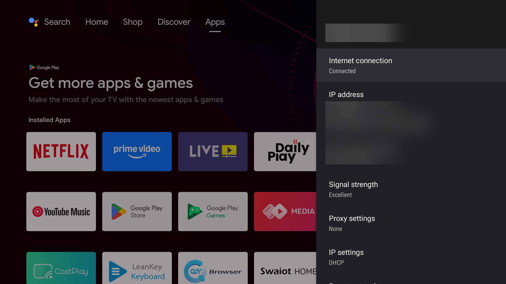

> The *Daily Play* tile on the left is one of the preloaded ad apps this cleanup turns off.

### 2. Clone and set up the tools

```bash
git clone https://github.com/YOUR_USERNAME/cleanyourtv
cd cleanyourtv
python -m venv tools/venv
tools/venv/Scripts/pip install -r tools/requirements.txt     # macOS/Linux: tools/venv/bin/pip
export TV_HOST=192.168.1.50                                   # your TV's IP address
tools/venv/Scripts/python -I tools/tv.py --probe              # accept "Allow USB debugging?" on the TV
```

`--probe` prints the model, Android version and firmware. If it connects, you're ready.

**The easy route:** open the folder in your coding assistant, paste [`PROMPT.md`](PROMPT.md) with your TV
model, and answer its checklist. It does steps 3–6 for you, with the same safety checks.

### 3. Back up the TV

Nothing changes yet. The assistant (or `tools/disable.sh`) saves the package lists, `getprop` and settings
to `backup/`, which stays on your computer and is never committed.

### 4. Disable the bloat, in small batches

Each batch is a plain text list of package names. Mine are in [`work/`](work/):

| Batch | List | What it turns off |
|---|---|---|
| 1. Tracking | [`batch1-telemetry.txt`](work/batch1-telemetry.txt) | Skyworth ACR (identifies what's on screen for ad targeting), Google feedback, partner setup, Play auto-installs |
| 2. Ads | [`batch2-ads.txt`](work/batch2-ads.txt) | "Daily Play" sponsored app, Shop-tab customizer, Google recommendation and "Featured" rows, e-POP demo player |
| 3. Leftovers | [`batch3-leftovers.txt`](work/batch3-leftovers.txt) | First-run leftovers, print spooler, e-manual, preloaded QJY browser, test shims, calendar sync |
| 4. Your choice | [`batch4-choices.txt`](work/batch4-choices.txt) | Apps I don't use: Play Movies, Play Games, Works with Alexa |

```bash
bash tools/disable.sh work/batch1-telemetry.txt
tools/venv/Scripts/python -I tools/tv.py --screenshot shots/02-after-batch1.png   # check the TV after each batch
bash tools/disable.sh work/batch2-ads.txt
# ...and so on
```

For a different TV model, look for its folder in [`examples/`](examples/), or let `PROMPT.md` find the
bloat on your TV. **Never disable** Live TV/input services, the remote/Bluetooth, keyboards, or Play
Store/Services. The scripts refuse Android core packages.

| After batch 1 (tracking) | After batch 2 (ads) |
|---|---|
| 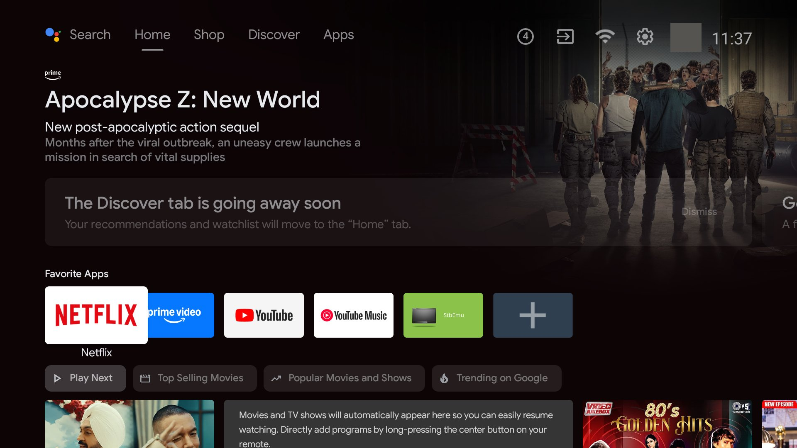 |  |

| Input key still works | After batch 3 | After batch 4 |
|---|---|---|
| 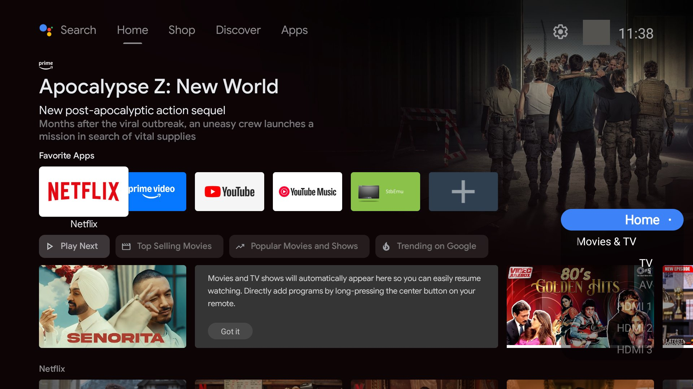 | 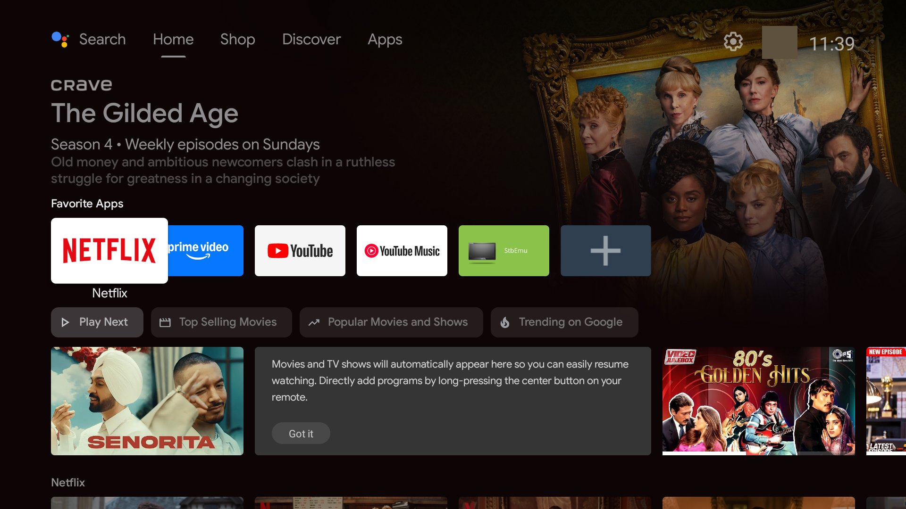 | 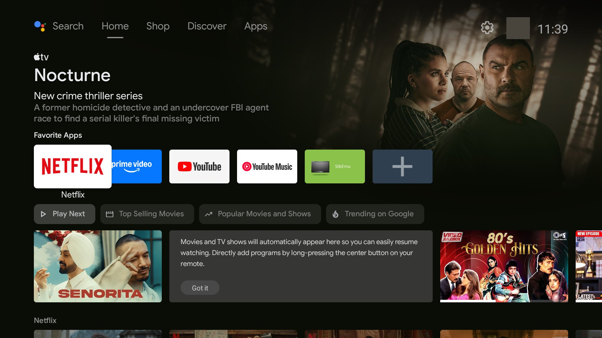 |

After a reboot everything stays disabled:

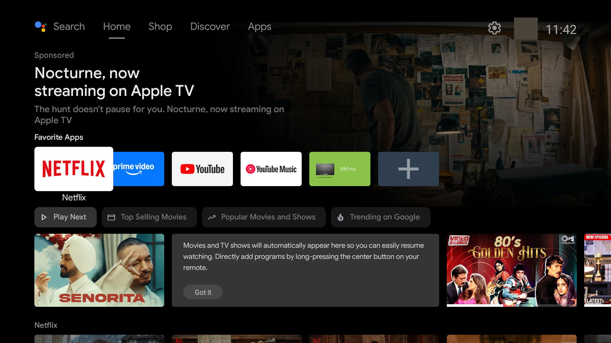

The stock launcher's banner is still sponsored, because Google serves it. Step 5 replaces the whole home screen.

### 5. Build and install the new launcher

Set your dock apps and grid size in [`launcher/app/src/main/res/values/config.xml`](launcher/app/src/main/res/values/config.xml).
My changes:

```xml
<string-array name="dock_apps">
    <item>com.netflix.ninja</item>                        <!-- Netflix -->
    <item>com.amazon.amazonvideo.livingroom</item>        <!-- Prime Video -->
    <item>com.google.android.youtube.tv</item>            <!-- YouTube -->
    <item>com.google.android.youtube.tvmusic</item>       <!-- YouTube Music -->
    <item>in.startv.hotstar</item>                        <!-- JioHotstar -->
</string-array>
<string-array name="hidden_apps">
    <item>com.smartdevice.livetv</item>                   <!-- Skyworth Live TV (it's in the Inputs menu instead) -->
</string-array>
<string name="live_tv_package">com.smartdevice.livetv</string>
<integer name="columns">5</integer>
```

To list your TV's package names: `tools/venv/Scripts/python -I tools/tv.py "pm list packages"`.

Build in Docker and install (no JDK/SDK needed, Docker Desktop must be running):

```bash
TV_HOST=<tv ip> bash work/build-and-install.sh
```

Without Docker, run `TV_HOST=<tv ip> launcher/build-and-install.sh` with JDK 17 and Android SDK 34 installed.
The script installs the launcher, confirms it is Home, and only then disables the stock launcher.

| New home | Dock focus moves right | App grid below the dock |
|---|---|---|
|  | 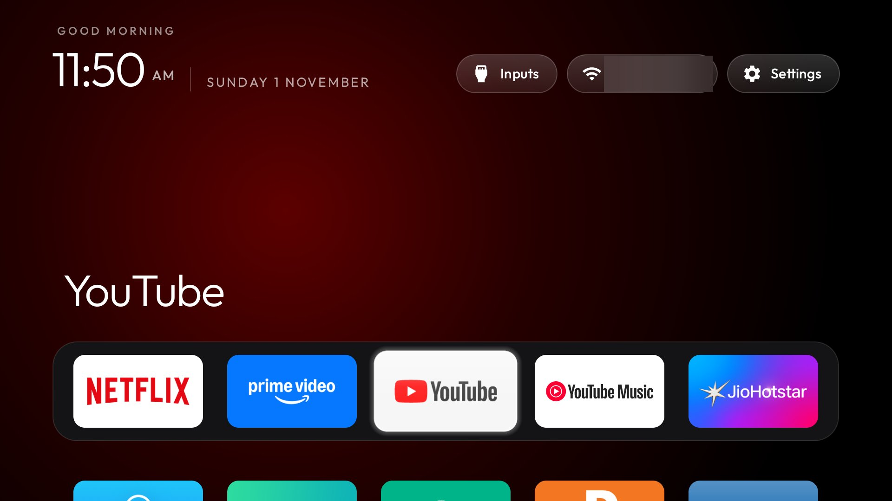 | 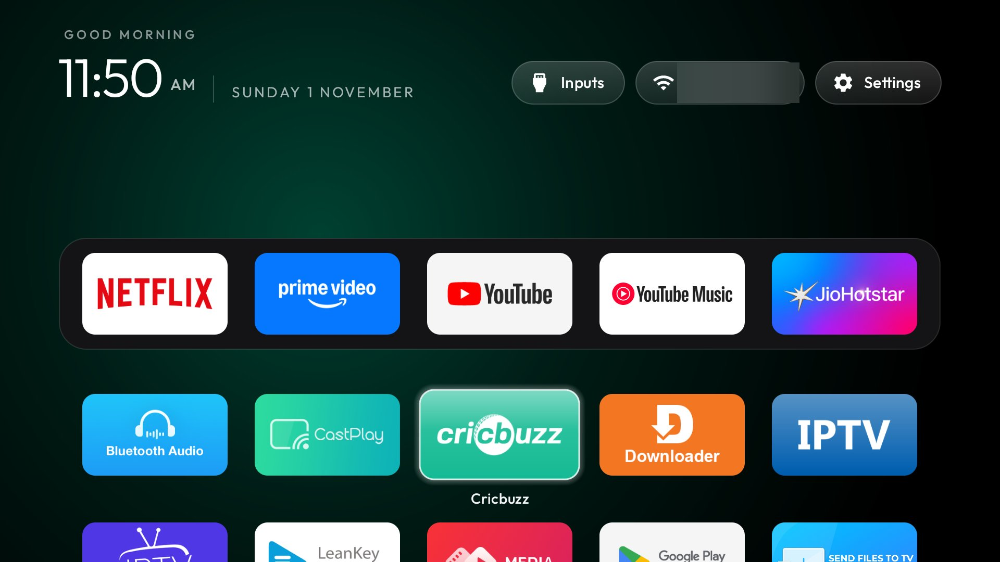 |

| Top bar | Inputs menu (HDMI 1–3, AV, Live TV) | Settings shortcut |
|---|---|---|
| 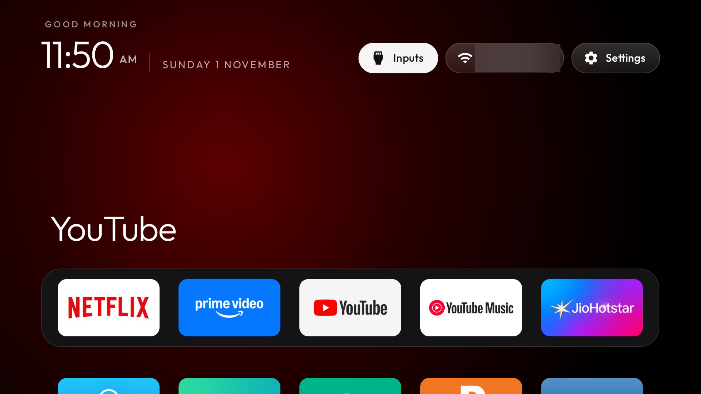 | 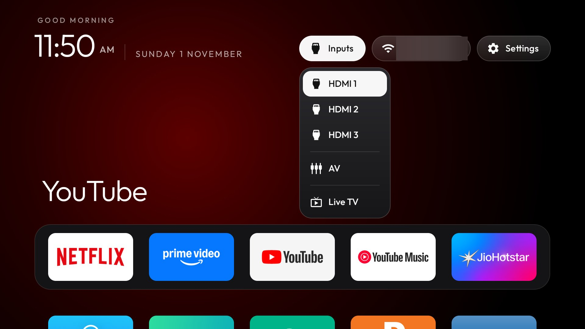 | 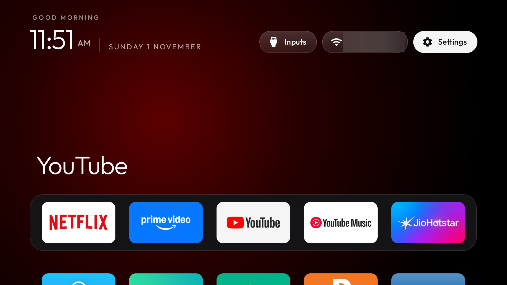 |

The new launcher still comes up as Home after a reboot:


### 6. Optional: ad-blocking DNS

```bash
tools/venv/Scripts/python -I tools/tv.py "settings put global private_dns_mode hostname"
tools/venv/Scripts/python -I tools/tv.py "settings put global private_dns_specifier dns.adguard-dns.com"
```

This blocks most in-app ads and trackers. It **can't block YouTube ads**, which come from the same servers
as the videos:

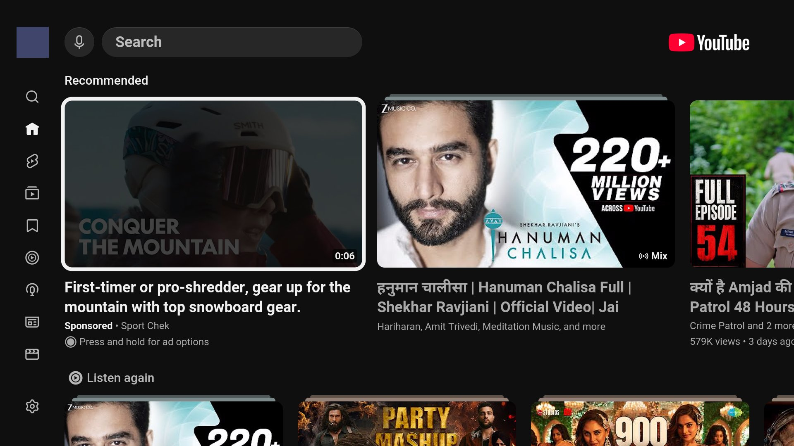

### 7. Turn debugging off

When you're done, switch **USB debugging** and **Network/Wireless debugging** off in Developer options, then
reboot. Check that the ADB port is closed:

```bash
tools/venv/Scripts/python -I tools/adb-closed.py <tv ip>
```

---

## Undo

Everything was disabled, not uninstalled. Turn debugging back on, then:

| Undo | Command |
|---|---|
| **Everything** (all batches, stock launcher, DNS) | `TV_HOST=<tv ip> bash work/restore-all.sh` |
| **One app** | `TV_HOST=<tv ip> tools/venv/Scripts/python tools/tv.py "pm enable --user 0 <package>"` |
| **Only the DNS** | `TV_HOST=<tv ip> tools/venv/Scripts/python tools/tv.py "settings put global private_dns_mode opportunistic"`, or on the TV: Settings → Network & Internet → Private DNS → Automatic |

More detail: [`work/README.md`](work/README.md) and [`docs/restore.md`](docs/restore.md).

---

## Customise the look

Push a theme (a folder with `config.json` and a 1920×1080 `wallpaper.jpg`) without rebuilding:

```bash
TV_HOST=<tv ip> bash tools/theme.sh themes/aurora     # a ready-made theme
TV_HOST=<tv ip> bash tools/theme.sh --reset           # back to the built-in look
```

All theme keys are in [`themes/README.md`](themes/README.md). To keep your dock in a theme, add
`"dock_apps": [...]` and `"columns": 5` to its `config.json`.

---

## Repo layout

| Path | What it is |
|---|---|
| [`PROMPT.md`](PROMPT.md) | The prompt to paste into a coding assistant; contains the safety rules |
| [`work/`](work/) | My Skyworth SWTV-20NA batch lists, build and restore scripts |
| [`docs/screenshots/`](docs/screenshots/) | The screenshots above, with Wi-Fi name, IP, MAC and account avatars blurred |
| [`launcher/`](launcher/) | The launcher source (plain Java, `minSdk` 26, no network access) |
| [`tools/`](tools/) | Pure-Python ADB client (`tv.py`), disable/restore/check scripts, Docker build |
| [`examples/`](examples/) | Tested debloat lists for hundreds of other TV models |
| [`themes/`](themes/), [`addons/`](addons/) | Optional looks and module-card apps |
| [`docs/TROUBLESHOOTING.md`](docs/TROUBLESHOOTING.md) | Fixes for connection and Home-screen problems |

---

## Credits and licence

Built on **[CleanYourTV](https://github.com/Gathin23/cleanyourtv)** by Gathin and its contributors
([cleanyour.tv](https://cleanyour.tv)). All tools, the launcher and the TV lists come from that project.
This repo adds my TV's configuration, notes and screenshots.

MIT licence, see [LICENSE](LICENSE). Use at your own risk: the changes are reversible, but you're
responsible for your TV.
